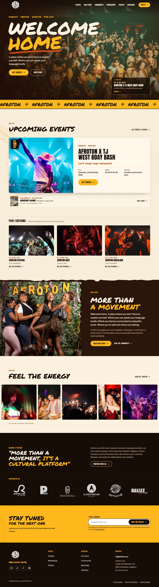
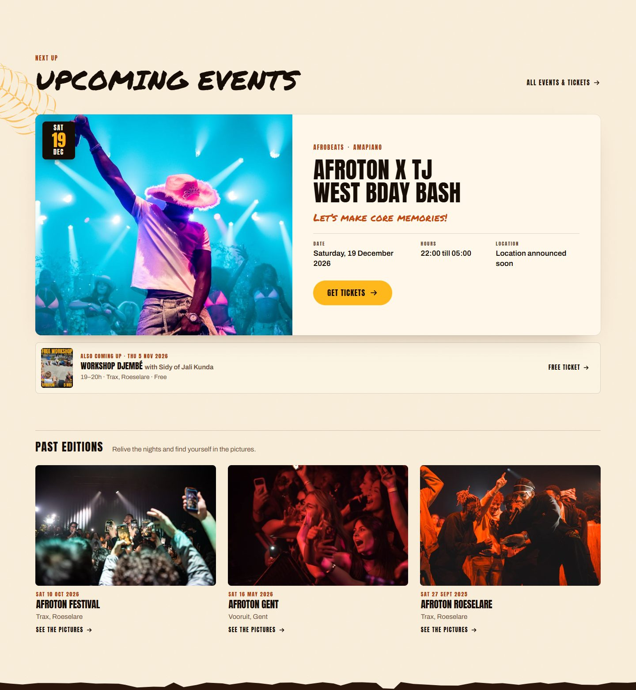
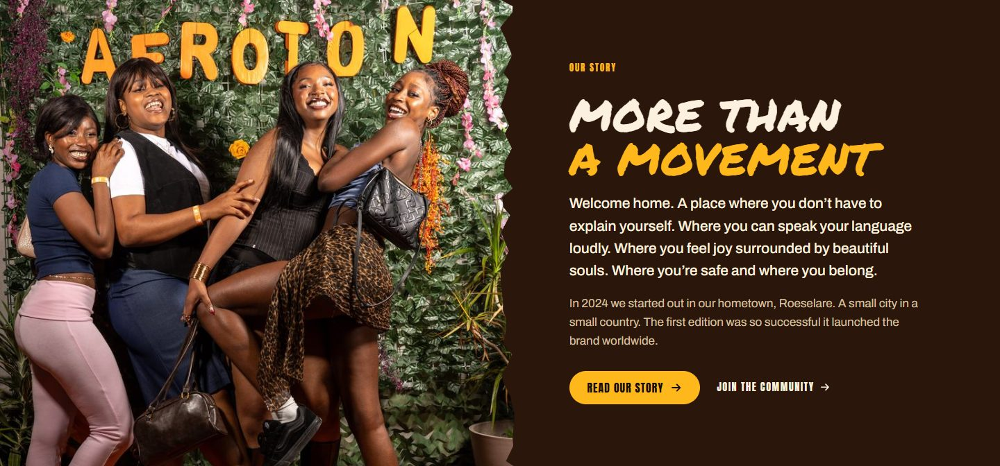
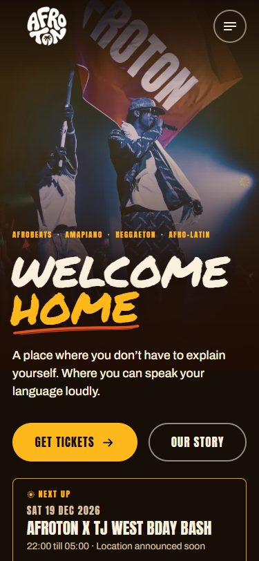
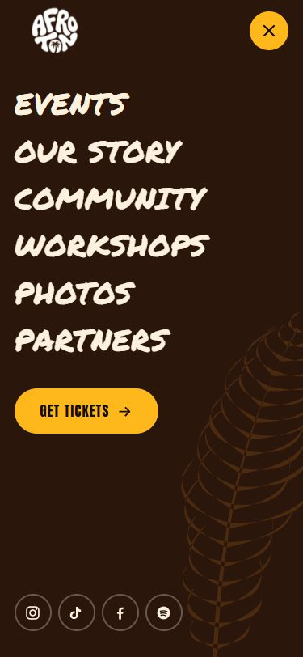
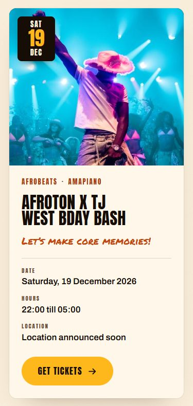

# Afroton Website Redesign

*An independent, unofficial redesign concept. Afroton's name, logo, photography and content belong to Afroton;
this project is not affiliated with, commissioned by or endorsed by Afroton.*

## Context

Afroton is an Afro-Latin inspired movement from Roeselare, Belgium. Since its first party in 2024 it has grown into
festivals, club nights, workshops and an artist roster, built around one idea: *welcome home*, a place where you
don't have to explain yourself.

This concept reimagines afroton.eu as a festival website with an editorial feel. It uses only what the live site
publishes: its events, copy, photography, logo, partners and legal texts. Nothing was invented to fill space.

## Problem

The existing site is a static export of a WordPress/Elementor build. It works, but:

- **Weak first impression.** A flat orange gradient hero where Afroton's strongest asset, its crowd photography, is missing.
- **Event discovery is buried.** The next party, the last edition and the newsletter share one stack of
  overlapping cards, and the upcoming workshop isn't on the home page at all.
- **Generic structure.** Repeated emoji tickers, page-builder headings and the same rhythm in most sections.
- **Inconsistent inner pages.** Pages vary in structure, and some "meet us" and booking forms are empty widgets
  left over from the WordPress export.

## Design direction

- **Keep the identity.** The real bubble-letter AFROTON roundel, the brand orange (#FF9C00) and Anton headlines stay.
- **Photography first.** Real Afroton nights fill the hero, story and gallery; decoration never competes with faces.
- **Stronger hierarchy.** One giant headline (the hero), calm section titles, a clear eyebrow → title → body → metadata order.
- **A warmer, editorial language.** Cream paper, deep cocoa panels, sun yellow and a brush voice used sparingly.
- **Event discovery.** The next party leads; workshops follow as a secondary line; past editions lead to their photos.
- **Mobile as its own layout.** Compositions are redesigned for phones, not shrunk.

## Key improvements

| Area | Change |
|---|---|
| **Hero** | Full-bleed crowd photo with a gradient only where the type sits, "WELCOME HOME" in brush lettering, a genre line, two CTAs and a "Next up" card that links straight to tickets. On phones the photo takes the top of the screen and the words sit below the subject. |
| **Navigation** | Transparent over the photo and solid and slightly smaller once you scroll. A full-screen mobile menu that keeps keyboard focus inside it and closes with Escape, with a ticket CTA in both. |
| **Events** | One featured card for the upcoming party (date badge, styles, title, its own line, a Date · Hours · Location row, ticket button). An "Also coming up" line for the workshop. Quieter past-edition cards that open their photo set. |
| **Story** | A split composition: friends at the AFROTON wall beside a cocoa panel with a torn-paper edge, carrying the manifesto copy. |
| **Gallery** | A full-bleed strip of wide and tall frames on desktop and a swipeable row on phones, with photographer credits and a filterable gallery page with a keyboard-friendly lightbox. |
| **Partners** | A clear pitch, then the six confirmed partner logos with evened-out sizes in a fixed grid. |
| **Mobile** | Every page checked at 320–1920px: no sideways scrolling, no clipped text, tap targets of at least 24px. |
| **Accessibility** | Semantic headings, a skip link, visible focus everywhere, WCAG AA contrast, reduced-motion support (the ticker stops and nothing fades in), consent-gated Spotify/YouTube players and a labelled, validated newsletter form. Lighthouse accessibility 100 on the pages tested. |

## Design system

**Colour**

| Token | Hex | Use |
|---|---|---|
| Ink | `#160D07` | Night: header, footer, partner band |
| Cocoa | `#2A160B` | Story and page-hero panels |
| Cream | `#FBF1DE` | Paper: default page ground |
| Sand | `#F3E0BF` | Secondary cream sections |
| Sun | `#FFB81C` | Ticker, buttons, newsletter band |
| Orange | `#FF9C00` | Brand orange, palm motif |
| Flame / Flame text / Rust | `#E5531C` / `#C4470F` / `#A93C10` | Brush accents; orange text on cream (AA) |

**Typography.** *Permanent Marker* for the brush voice (the hero and section titles only), *Anton* for labels, dates,
navigation and event titles (Afroton's existing headline face), and *Archivo* for reading text. All are self-hosted.
Only the hero is giant; section titles top out at about 3.8rem.

**Spacing.** A 1280px content column with fluid gutters (16–44px) and fluid section padding (64–136px). Sections
alternate between dark and light grounds, so the page reads as a rhythm rather than a stack of cards.

**Buttons.** Pill buttons in Anton capitals. Sun yellow is the primary action (tickets), with ink, outline and
ghost variants. The arrow slides on hover, the button lifts slightly, and focus shows a 3px ring.

**Motifs, used sparingly.** One brush underline (under "HOME"), a torn-paper edge where a dark panel meets cream,
a single palm frond near the edge of a section, the sun mark in the AFROTON ticker, and paper grain behind the
events. Every motif has a fixed place, so none of it is random decoration.

## Responsive design

- **Desktop (1440–1920px).** Split compositions (event card, story, partner pitch) and a five- or seven-frame
  gallery strip. The content column is capped, while photography runs full-bleed.
- **Tablet (768–1024px).** The same structure with tighter columns. Navigation moves into the menu below 1100px, and the
  event card keeps its side-by-side layout.
- **Mobile (320–700px).**
  - The hero becomes photo-over-text.
  - The featured event stacks with its facts in a single column.
  - Past editions and the gallery become swipeable rows where the next item peeks in.
  - Partners sit in a 3×2 grid.
  - Buttons go full width where it helps the thumb.

| Mobile hero | Mobile menu | Event card |
|---|---|---|
|  |  |  |

## Result

A concept for afroton.eu that feels like an Afroton night: warm, joyful, photographic and unmistakably theirs, with
the next party one tap away on every page. It keeps every real piece of content and the live site's interaction
patterns (ticket shop embed, consent choices, newsletter form). It adds a consistent design system across thirteen
pages and a mobile experience designed on its own terms. Mobile Lighthouse scores were 85–98 for performance on
content pages and 100 for accessibility on every page tested. In this concept build, the newsletter endpoint is a
local stand-in.

All screenshots are in [`docs/presentation/`](presentation/).
